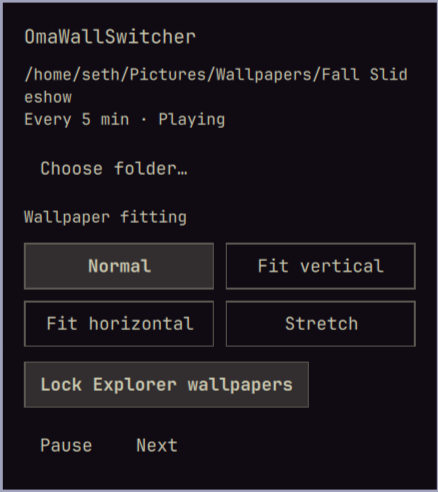

# OmaWallSwitcher

A lightweight wallpaper slideshow for Omarchy 4. Rotate images from a folder,
show a different wallpaper on each monitor, and switch fitting modes with smooth
transitions.



## Install

Uses Omarchy's bundled Quickshell, Python 3, Python GObject bindings, and
XDG desktop portal. No additional dialog package or manual setup is required.
Folder selection uses your system's configured file chooser.

```sh
omarchy plugin add https://github.com/seth-reee/OmaWallSwitcher.git --enable
```

Choose the `right` bar section when prompted. Click the wallpaper icon, then
**Choose folder…** to select your images. Type the rotation interval in
**Minutes between wallpapers** (1–1440, default: five minutes). Press Enter or
leave the field to save.

Images cycle in filename order. Add images directly to the selected folder;
subfolders are not included. Supported formats are JPG, JPEG, PNG, WebP, BMP,
and AVIF, depending on your installed Qt image plugins.

## Controls

| Action | Result |
| --- | --- |
| Left-click the bar icon | Open slideshow controls |
| Middle-click the bar icon | Pause or resume |
| Right-click the bar icon | Open the system folder picker |
| Double-left-click empty desktop | Next image on all monitors, even while paused |
| Double-right-click empty desktop | Open Omarchy's theme selector |

The popup includes folder selection, an editable rotation interval, pause/resume,
next image, and four fitting modes:

| Fitting | Behavior |
| --- | --- |
| Normal | Fill the screen, preserving proportions and cropping edges |
| Fit vertical | Match screen height and center horizontally |
| Fit horizontal | Match screen width and center vertically |
| Stretch | Fill the screen without preserving proportions |

Vertical and horizontal fitting add black bars or crop overflow as needed.
Settings apply to all monitors and are saved across restarts. The slideshow
restarts from the first filename when the shell restarts.

## Optional Lock Explorer support

With [Lock Explorer](https://github.com/SirJul1337/omarchy-lock-explorer), each
monitor's lock screen can show its current slideshow wallpaper, including during
the unlock fade.

After installing both plugins, turn on **Lock Explorer wallpapers** in the
OmaWallSwitcher popup. This option is off by default. No manual bridge command
is needed.

### How the bridge works

- Enabling the option checks Lock Explorer's installed `Service.qml` and adds
  the wallpaper bridge if it is missing. The same check runs when OmaWallSwitcher
  starts with this option enabled. Lock Explorer must already be installed.
- Before patching, the installer verifies the expected integration points and
  backs up the original file as `Service.qml.before-omawallswitcher` beside it.
  Later installations preserve existing backups and create a separate backup.
  Unsupported layouts produce an error without changing Lock Explorer or enabling
  a previously disabled option. The bridge changes wallpaper sources; it does
  not change password handling or authentication.
- When a bridge is installed, OmaWallSwitcher schedules a shell restart after
  two seconds. A full restart is needed because Omarchy keeps the lock service
  loaded across plugin rescans. The bar briefly reloads. Omarchy refuses this
  restart while the session is securely locked; unlock and run
  `omarchy restart shell` if installation happened while locked.
- OmaWallSwitcher publishes the image actually displayed on each monitor to
  `$XDG_RUNTIME_DIR/omawallswitcher-lock-wallpapers.json`. It refreshes this local
  state when wallpapers change and every 30 seconds. Lock Explorer watches the
  file and uses the matching monitor's path for the lock screen, full-screen
  preview, and unlock background.
- If a monitor has no slideshow image, sharing is disabled, or the state is more
  than 90 seconds old, Lock Explorer falls back to its normal theme wallpaper.
  This prevents a stopped or removed slideshow from leaving a stale lock image.

Lock Explorer keeps its own cropping, blur, and dim settings. Designs without a
wallpaper stay as designed. The bridge shares images, not slideshow fitting modes.

If a Lock Explorer update removes the bridge, toggle **Lock Explorer wallpapers**
off and on to reinstall it, or restart the shell with the option enabled. An
already installed bridge is left alone and does not trigger another restart.
Installation errors appear in the OmaWallSwitcher popup.

To stop sharing, turn off the option. The bridge can remain installed and will
fall back to the theme wallpaper. Backups remain beside Lock Explorer's
`Service.qml`; restoring one manually should only be done against the matching
Lock Explorer version.

## Update or remove

Update:

```sh
omarchy plugin update seth.wallpaper-slideshow
omarchy restart shell
```

Disable to reveal the normal Omarchy wallpaper:

```sh
omarchy plugin disable seth.wallpaper-slideshow
```

Remove:

```sh
omarchy plugin remove seth.wallpaper-slideshow
```

Your image folder is never modified. Saved preferences remain in
`~/.config/omarchy/wallpaper-slideshow.json` and can be deleted separately.

## Credits and license

[MIT](LICENSE). Reveal geometry and theme-selector integration adapted from
[Omarchy](https://github.com/basecamp/omarchy). Inspired by
[Omawall](https://github.com/matjam/omawall) and
[wallpaper-omarchy-manager](https://github.com/guiestrela/wallpaper-omarchy-manager).
