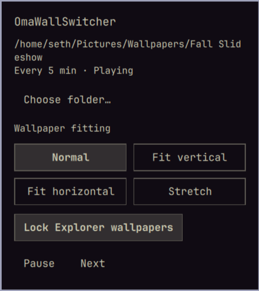

# OmaWallSwitcher

A lightweight wallpaper slideshow for the Omarchy shell. Cycle a folder of images,
use a different wallpaper on each monitor, and change fitting without abrupt jumps.
Wallpaper and fitting changes use Omarchy's center-out slanted reveal, with the old
image kept visible until its replacement is ready.



## Features

- Automatic rotation every 1–1440 minutes, with pause/resume and manual advance.
- Filename ordering, wrapping at the end; new files are discovered on the next slide.
- Different images per monitor when the folder contains enough images.
- Normal, Fit vertical, Fit horizontal, and Stretch fitting.
- Double-left-click the desktop to advance; double-right-click for Omarchy's theme selector.
- Two image buffers per monitor, with no folder-wide decoded image cache.
- Local operation: no network requests or additional wallpaper daemon.

## Requirements

Omarchy with its Quickshell-based shell, Python 3, and `zenity` for folder and
interval dialogs. `notify-send` provides optional error notifications. Image format
support depends on the Qt image plugins installed on your system.

## Install

```sh
omarchy plugin add https://github.com/seth-reee/OmaWallSwitcher.git --enable
```

Choose the `right` bar section when prompted. Click the wallpaper icon, then
**Choose folder…** to select a folder and interval. The default interval is five minutes.

For a manual installation, copy the root QML files, `TextSafety.js`, `slideshow.py`,
and `manifest.json` to `~/.config/omarchy/plugins/seth.wallpaper-slideshow/`, then run:

```sh
omarchy plugin validate ~/.config/omarchy/plugins/seth.wallpaper-slideshow
omarchy-shell shell rescanPlugins
omarchy plugin enable seth.wallpaper-slideshow --section right
```

After updating plugin code, restart the shell if a rescan retains an old component:

```sh
omarchy restart shell
```

The plugin ID remains `seth.wallpaper-slideshow` for compatibility with existing installs.

## Update or remove

Update a git-managed installation:

```sh
omarchy plugin update seth.wallpaper-slideshow
omarchy restart shell
```

Disable the slideshow to reveal the normal Omarchy wallpaper:

```sh
omarchy plugin disable seth.wallpaper-slideshow
```

Remove the plugin:

```sh
omarchy plugin remove seth.wallpaper-slideshow
```

Your image folder is never modified. The saved preferences in
`~/.config/omarchy/wallpaper-slideshow.json` can be removed separately if desired.
Installation and removal use Omarchy's plugin commands; no custom install scripts
or privileged commands are required.

## Controls

| Action | Result |
| --- | --- |
| Left-click the bar icon | Open slideshow controls |
| Middle-click the bar icon | Pause or resume |
| Right-click the bar icon | Choose folder and interval |
| Double-left-click empty desktop | Advance all monitors, including while paused |
| Double-right-click empty desktop | Open Omarchy's theme selector |

The popup includes folder selection, pause/resume, next image, and fitting buttons.

| Fitting | Behavior |
| --- | --- |
| Normal | Fill the screen, preserve proportions, crop edges |
| Fit vertical | Match screen height and center horizontally |
| Fit horizontal | Match screen width and center vertically |
| Stretch | Fill the screen without preserving proportions |

Vertical and horizontal fitting use black bars where needed and crop overflow.
Fitting applies to all monitors, uses the same reveal as wallpaper changes, and
persists across restarts. Animations respect Omarchy's animation setting.

## Settings and IPC

Settings are stored in `~/.config/omarchy/wallpaper-slideshow.json`. Images are read
directly from the selected folder, without recursion. Supported filename extensions:
JPG, JPEG, PNG, WebP, BMP, and AVIF.

Configure without dialogs:

```sh
python3 ~/.config/omarchy/plugins/seth.wallpaper-slideshow/slideshow.py configure \
  --folder ~/Pictures/Wallpapers --minutes 5
```

```sh
omarchy-shell wallpaper-slideshow status
omarchy-shell wallpaper-slideshow next
omarchy-shell wallpaper-slideshow toggle
omarchy-shell wallpaper-slideshow configure
omarchy-shell wallpaper-slideshow setFit vertical
```

`setFit` accepts `normal`, `vertical`, `horizontal`, or `stretch`.

## Memory and behavior

The plugin runs inside the Omarchy shell process. Only current and incoming images
are held per monitor. Decode requests are sized for the monitor's physical resolution;
the outgoing image is released after the reveal, and Qt's image cache is disabled.
The reveal temporarily uses mask/render targets, which are disabled afterwards.

A 2560×1600 RGBA image is approximately 15.6 MiB. Actual RAM and GPU memory also
include decoder buffers, render targets, allocator retention, and shell overhead;
the shell process's total memory usage includes all its other plugins.

The current image remains visible if a replacement cannot be decoded. Errors pause
automatic advances; press Next to try the following image or choose a valid folder.
Rapid changes keep the latest requested wallpaper/fitting while a reveal finishes.

The slideshow sits above the normal Omarchy background and below application windows.
Disabling it reveals the normal background again. Theme selection still changes the
desktop theme, while the slideshow continues showing its chosen folder. The lock
screen continues using Omarchy's normal background. The slideshow starts from the
first filename after a shell restart.

## Development

```sh
python3 -m unittest discover -s tests -v
python3 tests/run_qml.py
omarchy plugin validate .
```

The QML runner requires Qt 6 with Qt Quick, Quick Effects, Quick Shapes, and Qt Test.
It generates temporary image fixtures and a minimal Style module, leaving personal
settings untouched. It checks fitting geometry, outgoing-image retention, failed
loads, rapid changes, animation-disabled behavior, and tooltip text handling.
Software rendering tests verify state and geometry; inspect the reveal on a running
Omarchy desktop to verify GPU appearance. GitHub Actions runs the Python helper tests.

## Credits and license

MIT; see [LICENSE](LICENSE). The reveal geometry and theme-selector integration are
adapted from [Omarchy](https://github.com/basecamp/omarchy). The project was informed
by [Omawall](https://github.com/matjam/omawall) and
[wallpaper-omarchy-manager](https://github.com/guiestrela/wallpaper-omarchy-manager).

### Optional Lock Explorer wallpapers

For [Lock Explorer](https://github.com/SirJul1337/omarchy-lock-explorer), install
our optional compatibility bridge once:

```sh
python3 integrations/lock-explorer.py
```

Then enable **Lock Explorer wallpapers** in the OmaWallSwitcher popup, or run:

```sh
omarchy-shell wallpaper-slideshow setLockScreenSupport true
```

Off by default. Each lock surface and its unlock fade use that monitor's last
successfully displayed slideshow image. Lock Explorer retains its own crop,
blur, and dim settings; slideshow fitting modes do not carry over. Designs
without a wallpaper stay as designed. Explorer thumbnails retain the theme
wallpaper; the full-screen preview uses its monitor's slideshow image.

The bridge reads only a small JSON file in `XDG_RUNTIME_DIR`, keyed by monitor
name. It falls back to the theme wallpaper when disabled, missing a monitor,
or when the slideshow stops refreshing its state for 90 seconds. No global
wallpaper link or authentication behavior is changed. This does not replace
the stock desktop background service.

The installer backs up Lock Explorer's `Service.qml` as
`Service.qml.before-omawallswitcher` and rejects layouts it does not recognize.
A Lock Explorer update can overwrite the patch: inspect/remove the old backup
and reapply the installer after updating. To undo, disable the setting and
restore that backup if it still matches your installed Lock Explorer version.
